  <picture>
    <source media="(prefers-color-scheme: dark)" srcset="./assets/banner-cubes-dark.svg">
    <source media="(prefers-color-scheme: light)" srcset="./assets/banner-cubes-light.svg">
    
  </picture>

  <picture>
    <source media="(prefers-color-scheme: dark)" srcset="https://readme-typing-svg.demolab.com?font=Fira+Code&weight=600&size=28&pause=1000&center=true&vCenter=true&width=900&height=60&color=A78BFA&lines=Junior+Software+Engineer%3BAI+Enthusiast%3BMachine+Learning+Enthusiast">
    <source media="(prefers-color-scheme: light)" srcset="https://readme-typing-svg.demolab.com?font=Fira+Code&weight=600&size=28&pause=1000&center=true&vCenter=true&width=900&height=60&color=6D28D9&lines=Junior+Software+Engineer%3BAI+Enthusiast%3BMachine+Learning+Enthusiast">
    
  </picture>

  
  
  
  

---

## About Me

<table>
  <tr>
    <td width="60%" valign="middle">

I'm a **Junior Software Engineer** based in Malang, Indonesia, currently studying at **SMK Negeri 4 Malang**. I love turning ideas into working products and exploring how **AI and Machine Learning** can solve real-world problems.

- Building full-stack web and mobile apps with **Flutter**, **Next.js**, and **Laravel**
- Deepening my knowledge of **Machine Learning** and **AI engineering**
- Open to collaboration on open-source and student projects
- Ask me about anything related to frontend, backend, or mobile development

  </td>
    <td width="40%" align="center" valign="middle">
      
    </td>
  </tr>
</table>

---

## Tech Stack

### Languages

### Frameworks and Frontend

### Backend and Servers

### Databases

### Cloud and DevOps

### Data and Machine Learning

### Design and Tools

---

## GitHub Stats

  
  

  

---

## Contribution Graph

  <picture>
    <source media="(prefers-color-scheme: dark)" srcset="https://raw.githubusercontent.com/Latarombo/Latarombo/output/pacman-contribution-graph-dark.svg">
    <source media="(prefers-color-scheme: light)" srcset="https://raw.githubusercontent.com/Latarombo/Latarombo/output/pacman-contribution-graph.svg">
    
  </picture>

---

## Featured Projects

  
  

  
  

  <a href="https://github.com/Latarombo?tab=repositories"><strong>View all repositories</strong></a>

---

## Connect with Me

<table align="center">
  <tr>
    <td align="center" width="33%">
      
    </td>
    <td align="center" width="33%">
      
    </td>
    <td align="center" width="33%">
      
    </td>
  </tr>
</table>

---

## Dev Quote

  <picture>
    <source media="(prefers-color-scheme: dark)" srcset="https://quotes-github-readme.vercel.app/api?type=horizontal&theme=github_dark&backgroundColor=22272e&quoteColor=adbac7&authorColor=768390&symbolColor=539bf5">
    <source media="(prefers-color-scheme: light)" srcset="https://quotes-github-readme.vercel.app/api?type=horizontal&theme=github_dark&backgroundColor=ffffff&quoteColor=1f2328&authorColor=59636e&symbolColor=0969da">
    
  </picture>

---

Thanks for stopping by. Let's build something great together.

